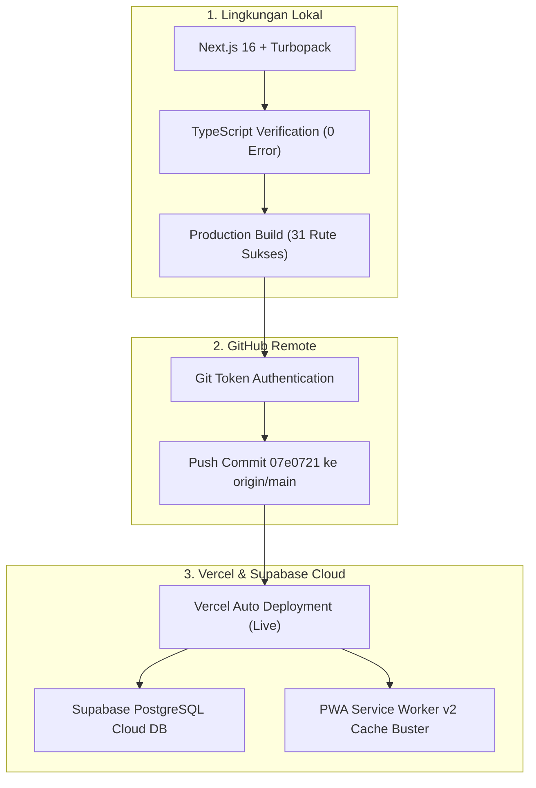

# CETAK.INC — REKAPITULASI PROGRES & LAPORAN PENGEMBANGAN SISTEM
**Transformasi Platform Percetakan On-Demand Presisi Tinggi (Level Astro & Gojek)**  
*Dokumen Status: Produksi Aktif — Sinkronisasi Git Commit `07e0721` — Next.js 16 + Supabase Cloud + PWA Engine*

---

## 1. Ringkasan Eksekutif (Executive Summary)

Proyek **Cetak.inc** (BAS Advertising Padang) telah berhasil bertransformasi dari sekadar website profil percetakan konvensional menjadi **Platform Percetakan On-Demand Modern** dengan kecepatan, kenyamanan, dan arsitektur setara aplikasi *quick-commerce* terdepan seperti **Astro** dan **Gojek**.

Sistem ini menggabungkan:
1. **Frontend Super Cepat**: Next.js 16 (App Router & Turbopack), Tailwind CSS v4, Framer Motion, Lucide Icons.
2. **Backend & Database Tangguh**: Supabase Cloud PostgreSQL, Row Level Security (RLS), Next.js Serverless Route Handlers.
3. **PWA Native Engine**: Service Worker v2, Web App Manifest, Web Push Notifications, Offline Caching.
4. **Logistik & Operasional Terpadu**: Admin Dispatcher Kurir, Live Tracking Map interaktif berbasis GPS workshop Padang, dan Kalkulator Dimensi Luas ($P \times L$) real-time.

---

## 2. Rincian Implementasi 4 Pilar Utama Sistem

### 🛵 Pilar 1: Admin Dispatcher & Live Courier Tracking Engine
* **Admin Dispatcher Modal (`/urang-dalam-bas-adv`)**:
  * Ketika admin mengubah status pesanan menjadi `DIKIRIM`, muncul pop-up dispatcher pengiriman.
  * Fitur preset kurir cepat: *Budi Santoso (Kurir Internal)*, *Rian Syahputra (Kurir Workshop)*, *Maxim / GoSend Instant*, dan *J&T Cargo Padang*.
  * Input lengkap: Nama Kurir, Nomor WhatsApp/Telepon, Plat Nomor Kendaraan, Estimasi Tiba (ETA: 15–60 Menit), dan Catatan Khusus Pengantaran.
  * Indikator status kurir langsung terlihat di tabel pesanan admin.
* **Dual-Storage Fallback Database**:
  * Dirancang sangat tangguh (`src/lib/db/queries/orders.ts`): Menyimpan data kurir langsung ke kolom native database Supabase atau secara otomatis mem-fallback ke format tag `[COURIER_DATA:json]` di kolom `note` tanpa merusak riwayat transaksi.
* **Peta Pelacakan Interaktif Pelanggan (`/lacak`)**:
  * Peta Leaflet (Carto Voyager) responsif dengan titik penjemputan dari Workshop BAS Advertising Padang ke alamat pengiriman pelanggan.
  * Animasi motor kurir *live pulsing* yang bergerak dinamis.
  * Menampilkan kartu driver lengkap: foto kurir, plat nomor kendaraan, estimasi hitung mundur (ETA), tombol direct WhatsApp kurir, dan tombol panggilan telepon darurat.

---

### 📦 Pilar 2: Restrukturisasi & Master Katalog Cetak Siap Jual
* **Pembersihan Data Lama & Sampah Mockup**:
  * Menghapus seluruh data *hardcoded* lama yang menyebabkan glitch angka `89+` pada load awal.
* **Master Seed 15 Produk Standar Percetakan (`src/lib/db/printing-catalog-seed.ts`)**:
  * Terdiri dari 5 kategori utama dengan foto WebP resolusi tinggi dan deskripsi spesifikasi cetak lengkap:
    1. **Spanduk & Banner**: Spanduk Flexi China 280g ($m^2$), Spanduk Korea Higres 440g ($m^2$), X-Banner 60x160cm (Set Rangka), Roll Up Banner Luxury 85x200cm.
    2. **Stiker & Kemasan Label**: Stiker Vinyl Waterproof A3+ (Kiss-Cut), Stiker Kromo Ekonomis A3+, Stiker Transparan / Hologram Kemasan.
    3. **Media Promosi & Kantor**: Kartu Nama Exclusive 2 Sisi (Box 100 pcs), Brosur Art Paper A5 (Rim 500 lbr), Nota NCR 2-3 Rangkap Bernomor.
    4. **Merchandise & Sablon**: Kaos Sablon DTF Combed 30s, Totebag Kanvas Premium, Mug Keramik Custom Souvenir.
    5. **Signage & Akrilik**: Neon Box Bulat LED 2 Sisi, Plakat Akrilik Wisuda / Event.
* **Tombol 1-Klik Seeder di Admin**:
  * Endpoint `POST /api/admin/seed-printing` dan tombol hijau *"🌱 Isi Master Cetak"* di panel admin Urang Dalam untuk inisialisasi instan kapan saja.

---

### 🎨 Pilar 3: Integrasi Studio Mockup 3D ke Keranjang & WhatsApp
* **Studio Visualisasi Real-Time (`/mockup`)**:
  * Canvas interaktif berbasis `html2canvas` untuk produk Kaos Combed 30s & Totebag Kanvas.
  * Pemilihan warna kaos (Putih, Hitam, Navy, Merah Marun, Hijau Army) dan toggle tampilan (Depan / Belakang).
  * Pelanggan dapat mengunggah desain/logo sendiri, mengatur ukuran (*scaling*), dan memindahkan posisi logo di atas produk secara bebas.
* **Checkout Terintegrasi**:
  * Pemilih ukuran kaos (`S`, `M`, `L`, `XL`, `XXL`) dan kalkulator subtotal dinamis.
  * Tombol *"🛒 Masukkan Keranjang"*: Mengambil tangkapan layar (*snapshot*) kanvas otomatis, mengonversi ke file WebP terkompresi, menyuntikkan item ke keranjang belanja, dan membuka `CartDrawer`.
  * Tombol *"💬 Pesan Cepat via WA"*: Mengirim data mockup dan rincian ukuran langsung ke WhatsApp CS Cetak.inc.

---

### 🔔 Pilar 4: Progressive Web App (PWA) & Web Push Engine
* **Engine PWA & Offline Shell (`public/sw.js`)**:
  * Terdaftar dengan Web App Manifest resmi (`public/manifest.webmanifest`), ikon 192x192 & 512x512, dan theme color `#0B1E36`.
  * Strategi *Network-First* untuk dokumen HTML dan *Cache-First* untuk aset statis gambar dan styling.
* **Web Push Notification (`src/components/PushNotificationOptIn.tsx`)**:
  * Kartu perizinan notifikasi 1-tap di halaman `/lacak`.
  * Listener event `push` dan `notificationclick` di Service Worker yang memunculkan notifikasi native di layar kunci (*lockscreen*) smartphone saat status pesanan berubah menjadi `DIKIRIM`.
  * Aksi interaktif pada notifikasi: tombol *"🗺️ Buka Peta Live"* langsung membuka URL pelacakan pesanan.
* **Slim PWA Install Banner**:
  * Desain banner instalasi diubah menjadi horizontal pill ramping (~46px) di atas menu navigasi bawah agar tidak menghalangi tampilan produk.

---

## 3. Penyempurnaan Tampilan Mobile Portrait (Standar Astro & Gojek)

### 3.1. Grid 8 Kategori Beranda (4 × 2 Grid)
* Menggantikan teks terpotong (`…`) dengan label 2 baris proporsional (`line-clamp-2 h-6`).
* Identitas gradien warna cerah dan micro-badge:
  * 🌟 **Spanduk & Banner** (Badge `P×L`)
  * 🏷️ **Stiker & Label** (Badge `A3+`)
  * 📄 **Brosur & Nota** (Media Kantor)
  * 👕 **Kaos & Sablon** (Badge `DTF`)
  * 🏪 **Neon Box Akrilik** (Badge `LED`)
  * 🎨 **Studio 3D** (Badge `3D`)
  * 🛵 **Lacak Live** (Badge berkedip `LIVE`)
  * 📦 **Semua Produk** (Counter jumlah produk aktif)

### 3.2. Astro-Style Category Chips Rail
* Swipeable horizontal category rail tepat di atas feed produk beranda dan katalog.
* Memungkinkan pelanggan menyaring produk secara instan tanpa reload halaman (*zero latency*).

### 3.3. Penyelamatan Masalah Zoom-Out Safari iOS pada Halaman Katalog (`/produk`)
* **Akar Masalah**:
  * Pada layar iPhone, deretan chip kategori panjang (`whitespace-nowrap`) tanpa batas lebar memicu Safari menghitung lebar dokumen sebesar **1.110px**.
  * Karena `layout.tsx` mengizinkan `maximumScale: 5`, Safari secara otomatis memperkecil (*auto zoom-out*) seluruh website menjadi 33%, menyebabkan teks dan tombol menjadi mikroskopis.
* **Solusi yang Diterapkan**:
  1. Mengunci viewport pada `src/app/layout.tsx`: `width: "device-width", initialScale: 1, maximumScale: 1, userScalable: false`.
  2. Mengunci CSS global: `html, body { overflow-x: hidden; max-width: 100vw; width: 100%; }`.
  3. Membatasi kontainer halaman Katalog ke `w-full max-w-lg md:max-w-7xl mx-auto px-3.5` (sama persis dengan Beranda).
  4. Kartu produk dikunci dengan `w-full min-w-0 overflow-hidden` pada grid 2-kolom, judul dikunci `h-7 sm:h-8 line-clamp-2`, dan tombol aksi menggunakan tombol `+` kompak `w-7 h-7` (28px) ala Astro.

---

## 4. Status Teknis, Pipeline & Deployment

### Riwayat Commit Kunci (Git Log):
* `07e0721`: *fix(katalog): lock mobile viewport scale to 1:1 and match Beranda layout constraints exactly*
* `5a1558a`: *fix(mobile): enforce strict 2-column grid constraints with min-w-0, slim PWA prompt, and bump SW cache to v2*
* `03b4515`: *fix(mobile): resolve horizontal viewport overflow and revamp mobile catalog cards to native Astro/Gojek standard*
* `40c37e4`: *feat(mobile): revamp mobile portrait category grid and add Astro-style horizontal category chips rail*
* `2416f51`: *feat(push): add PWA Web Push notification engine with native lockscreen alerts and 1-tap opt-in*
* `1a794b1`: *feat(mockup): integrate 3D studio with cart drawer, live price calculation, size selection, and direct WhatsApp checkout*
* `0c2e7fa`: *feat(catalog): populate professional standard printing catalog with 15 ready-to-sell products and 1-click seeder*
* `9474521`: *feat(dispatch): add Admin Courier Dispatcher modal and real-time live map synchronization*
* `7faa38e`: *docs: add comprehensive project update blueprint for on-demand printing system*

---

## 5. Rekomendasi Fitur Berikutnya (Roadmap Lanjutan)

1. **Cetak Tiket SPK (Surat Perintah Kerja) & Struk Thermal (58mm / 80mm / A4)**:
   * Tombol cetak tiket kerja langsung dari detail pesanan di panel admin untuk diserahkan ke operator mesin cetak di workshop Padang.
2. **Pencarian Riwayat Pesanan via Nomor WhatsApp di `/lacak`**:
   * Pelanggan cukup mengetikkan nomor HP mereka untuk melihat seluruh daftar pesanan yang sedang diproses maupun yang sudah selesai.
3. **Integrasi QRIS Dinamis & Upload Bukti Bayar Otomatis**:
   * Menampilkan QRIS otomatis di akhir checkout dengan fitur upload bukti transfer terkompresi WebP.
