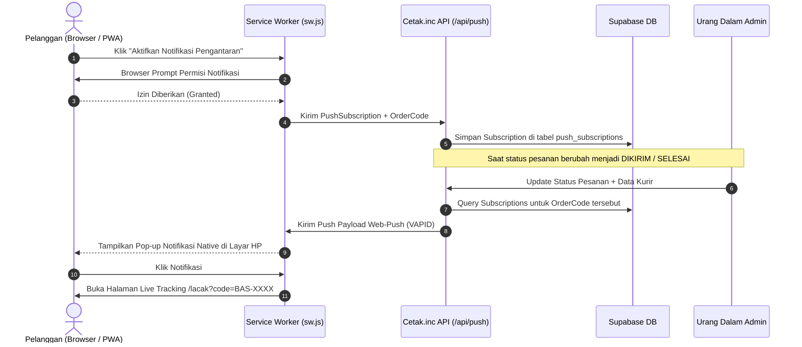

# CETAK.INC — MASTER PROJECT UPDATE & IMPLEMENTATION BLUEPRINT
**Dokumen Arsitektur & Rencana Kerja Sistem Percetakan On-Demand (Level Astro / Gojek)**
*Versi: 2.1 — Basis Operasional: Modular Monolith Next.js 16 + Supabase Cloud + PWA Engine*

---

## 1. Executive Summary & Visi Positioning

Transformasi **Cetak.inc** (BAS Advertising Padang) bertujuan mengubah paradigma website percetakan konvensional (katalog pasif & form kontak sederhana) menjadi **Platform On-Demand Precision Printing** yang memiliki *fluidity*, *responsiveness*, dan *user experience* setara aplikasi modern seperti **Astro** dan **Gojek**.

### Matriks Positioning Produk & Aspek Bisnis
| Aspek Sistem | Positioning Tradisional (Kompetitor) | Positioning Baru Cetak.inc (Astro/Gojek Level) | Keunggulan Strategis (Value Prop) |
| :--- | :--- | :--- | :--- |
| **Pemesanan Cetak** | Chat WA manual, tunggu admin hitung luas & harga berjam-jam | **Kalkulator Dimensi $P \times L$ Real-Time** dengan preset cepat & opsi finishing otomatis | Konversi instan; pelanggan langsung tahu estimasi harga presisi per $m^2$. |
| **Tracking Order** | "Masih dicetak kak" via chat tanpa kepastian waktu | **Live Interactive Tracking Map** dengan rute GPS dari Workshop Padang ke lokasi pelanggan | Transparansi penuh, menurunkan 70% beban CS untuk pertanyaan *"Sudah sampai mana?"*. |
| **Visualisasi Produk** | Foto contoh statis di katalog | **Studio Mockup 3D Interaktif** dengan tombol *"Pesan Desain Ini Langsung"* | Validasi instan sebelum cetak; memangkas revisi salah cetak/ukuran. |
| **Pengalaman Mobile** | Website lambat, zoom-in/out manual di layar HP | **PWA (Progressive Web App)** native feel, installable ke homescreen, support offline caching | Ringan (<2 detik loading), tanpa perlu unduh ratusan MB dari Play Store / App Store. |
| **Infrastruktur Media** | Foto mentah kamera 5-10 MB menumpuk dan membebani storage | **Sharp WebP Pipeline Engine** otomatis kompresi 96% (<100 KB) dengan folder partitioned | Storage Supabase 1 GB gratis mampu menampung >14.000 foto produk berkualitas tinggi. |

---

## 2. Pillar 1: Admin Dispatcher & Live Courier Tracking Engine

### 2.1. Positioning & Nilai Operasional
Sebagai jembatan antara tim produksi workshop di Padang dan kurir di lapangan. Ketika status pesanan diubah ke `DIKIRIM`, admin workshop dapat mengalokasikan kurir internal atau pihak ketiga dalam hitungan detik, yang secara otomatis memicu animasi driver dan estimasi waktu sampai (ETA) pada peta live pelanggan.

### 2.2. Frontend Requirements
1. **Modal Dispatcher Pengiriman (`/urang-dalam-bas-adv` - Tab 4: Pesanan)**:
   - Terpicu secara otomatis ketika admin mengklik tombol ubah status ke **"DIKIRIM"**.
   - Input Fields:
     - **Tipe Kurir**: Radio Button (`Kurir Internal Toko`, `Gojek / Grab / Maxim Instant`, `J&T / Ekspedisi Luar Kota`).
     - **Nama Kurir / Pengantar**: Teks (contoh: *"Budi Santoso"*).
     - **Nomor Telepon / WhatsApp Kurir**: Nomor HP aktif untuk panggilan darurat customer.
     - **Plat Nomor Kendaraan**: Teks (contoh: *"BA 4521 QZ"*).
     - **Estimasi Tiba (ETA)**: Slider / Pilihan Cepat (`15 Menit`, `30 Menit`, `45 Menit`, `60 Menit`).
     - **Catatan Pengantaran**: Teks instruksi untuk pelanggan (contoh: *"Kurir membawa paket spanduk lipat rapi"*).
2. **Badge Status Terpadu**:
   - Status terstandarisasi: `BARU` (Abu-abu), `DIPROSES` (Kuning), `SIAP` (Biru), `DIKIRIM` (Ungu Berkedip), `SELESAI` (Hijau), `BATAL` (Merah).
3. **Peta Pelacakan Customer (`/lacak`)**:
   - Leaflet Map Carto Voyager dengan marker pulsing motor kurir yang bergerak dinamis.
   - Sinkronisasi realtime data driver dari API tracking: Nama Kurir, Plat Nomor, Tombol Hubungi Driver, dan Tombol Buka Rute Google Maps.

### 2.3. Backend Requirements & Skema Database
1. **Database Schema Update (Tabel `orders` di Supabase & SQLite)**:
   ```sql
   ALTER TABLE orders ADD COLUMN IF NOT EXISTS courier_name TEXT;
   ALTER TABLE orders ADD COLUMN IF NOT EXISTS courier_phone TEXT;
   ALTER TABLE orders ADD COLUMN IF NOT EXISTS courier_plate TEXT;
   ALTER TABLE orders ADD COLUMN IF NOT EXISTS delivery_notes TEXT;
   ALTER TABLE orders ADD COLUMN IF NOT EXISTS estimated_delivery_at TEXT;
   ALTER TABLE orders ADD COLUMN IF NOT EXISTS courier_lat REAL;
   ALTER TABLE orders ADD COLUMN IF NOT EXISTS courier_lng REAL;
   ```
2. **API Endpoint Enhancements**:
   - `PATCH /api/orders/[id]`:
     - Validasi status baru: menerima `["BARU", "DIPROSES", "SIAP", "DIKIRIM", "SHIPPED", "SELESAI", "BATAL"]`.
     - Menyimpan payload kurir (`courierName`, `courierPhone`, `courierPlate`, `deliveryNotes`, `estimatedMinutes`) ke database.
   - `GET /api/orders/track?code=BAS-XXXX`:
     - Mengembalikan data pesanan lengkap beserta snapshot kurir dan koordinat untuk Leaflet map.

---

## 3. Pillar 2: Restrukturisasi & Pengisian Katalog Produk Standar Percetakan

### 3.1. Positioning & Sasaran Pasar
Menyediakan portofolio produk percetakan yang lengkap, terstruktur, dan terpercaya bagi pelaku UMKM, kedai kopi/kuliner, instansi pemerintah, dan panitia event di Sumatera Barat.

### 3.2. Struktur Kategori & Master Seed Produk
Kategori dan produk disusun dalam 5 pilar utama dengan logika perhitungan harga presisi:

```mermaid
graph TD
    A["Katalog Percetakan Cetak.inc"] --> B["1. Spanduk & Banner"]
    A --> C["2. Stiker & Kemasan Label"]
    A --> D["3. Media Promosi & Kantor"]
    A --> E["4. Merchandise & Sablon DTF"]
    A --> F["5. Signage & Plakat Akrilik"]
    
    B --> B1["Spanduk Flexi China 280g (/m2)"]
    B --> B2["Spanduk Korea Higres 440g (/m2)"]
    B --> B3["X-Banner Stand 60x160cm (/set)"]
    B --> B4["Roll Up Banner Luxury 85x200cm (/set)"]

    C --> C1["Stiker Vinyl Waterproof A3+ (/lbr)"]
    C --> C2["Stiker Kromo Ekonomis A3+ (/lbr)"]
    C --> C3["Stiker Transparan Hologram A3+ (/lbr)"]

    D --> D1["Kartu Nama Exclusive 2 Sisi (/box)"]
    D --> D2["Brosur Promosi Art Paper A5 (/rim)"]
    D --> D3["Nota NCR 2-3 Rangkap Bernomor (/buku)"]

    E --> E1["Kaos Sablon DTF High Density (/pcs)"]
    E --> E2["Tote Bag Kanvas Premium (/pcs)"]
    E --> E3["Mug Keramik Custom Souvenir (/pcs)"]

    F --> F1["Neon Box Bulat / Kotak 2 Sisi (/set)"]
    F --> F2["Plakat Akrilik Wisuda / Event (/pcs)"]
```



### 3.3. Spesifikasi Teknis Produk & Logika Harga
- **Spanduk & Banner**: Mengaktifkan modul kalkulator dimensi ($P \times L$) di frontend. Harga dasar dikali luas meter persegi, dengan opsi mata ayam dan selongsong gratis/tambahan.
- **Stiker A3+**: Mendukung opsi finishing: *Kiss Cut* (tinggal kelupas) dan *Die Cut* (potong putus per stiker).
- **Media Kantor & Brosur**: Penjualan berbasis kuantitas grosir (per Box 100 pcs, per Rim 500 lembar).
- **Backend Data Seeder (`src/lib/db/seed.ts` & Supabase Seeder)**:
  - Skrip seeder otomatis yang mengunggah master kategori, produk, deskripsi kaya spesifikasi, estimasi waktu pengerjaan (SLA), dan gambar WebP berkualitas tinggi.

---

## 4. Pillar 3: Integrasi 3D Studio Mockup ke Keranjang Belanja

### 4.1. Positioning & Diferensiasi
Fitur pembeda utama Cetak.inc dibanding percetakan lokal lainnya. Pelanggan tidak perlu menunggu layout desainer grafis berhari-hari; mereka dapat mengunggah logo/desain sendiri, memilih warna kaos atau totebag, melihat pratinjau realistik dari depan/belakang, dan langsung menekan tombol **"Pesan Desain Ini"**.

### 4.2. Frontend Workflow (`src/app/mockup/page.tsx`)
1. **Interactive Canvas Renderer**:
   - Dukungan mockup Kaos Polos Combed 30s & Totebag Kanvas (Depan & Belakang).
   - Dynamic Color Tinting (`#FFFFFF`, `#1E293B`, `#7F1D1D`, `#3F6212`, dll.).
   - Kontrol geser (*drag & drop*), ubah ukuran (*resizing*), dan rotasi desain stiker/logo di atas produk.
2. **Action: "Pesan Desain Mockup Ini Sekarang"**:
   - Menjalankan konversi canvas menjadi snapshot gambar WebP beresolusi tinggi menggunakan `html2canvas`.
   - Menampilkan modal konfirmasi cepat:
     - Pilihan Ukuran (S, M, L, XL, XXL) untuk Kaos.
     - Jumlah Pesanan (Pcs).
     - Input Catatan Tambahan (misal: *"Warna sablon tolong lebih cerah"*).
3. **Cart Integration**:
   - Item langsung disuntikkan ke keranjang belanja (`useCartStore` / LocalStorage) dengan thumbnail hasil render 3D pelanggan, nama produk kustom (*"Kaos Custom Sablon DTF (Desain Studio 3D)"*), dan atribut warna/ukuran yang dipilih.
   - Muncul notifikasi toast dan opsi langsung membuka Drawer Keranjang atau lanjut belanja.

### 4.3. Backend Requirements
1. **Endpoint Penyimpanan Pratinjau Desain (`/api/mockup/save-preview`)**:
   - Menerima `base64` gambar hasil render dari frontend.
   - Diproses melalui `sharp` menjadi WebP ringan (<150 KB).
   - Diunggah ke Supabase Storage bucket `assets/mockups/YYYY/MM/`.
   - Mengembalikan URL gambar permanen untuk dilampirkan pada `order_items.design_note` atau kolom `mockup_preview_url`.
2. **WhatsApp Order Formatter**:
   - Pesan WhatsApp pesanan otomatis menyertakan link URL hasil render 3D agar operator cetak langsung mengetahui posisi presisi sablon yang diinginkan pelanggan.

---

## 5. Pillar 4: Web Push Notification Engine (PWA Native Alerts)

### 5.1. Positioning & Retensi Pelanggan
Menghadirkan komunikasi status transaksi tanpa hambatan (*frictionless notifications*) langsung ke notifikasi lockscreen HP pelanggan, layaknya aplikasi native Android/iOS Gojek dan Astro.

### 5.2. Alur Kerja Push Notification


### 5.3. Frontend Requirements
1. **Komponen Smart Notification Banner (`src/components/PushNotificationOptIn.tsx`)**:
   - Tampil di halaman `/lacak` dan halaman konfirmasi keranjang setelah checkout.
   - Teks ajakan: *"Ingin tahu saat kurir berangkat? Aktifkan notifikasi pengantaran langsung di HP Anda."*
2. **Service Worker Push Listener (`public/sw.js`)**:
   - Mendengarkan event `self.addEventListener('push', ...)` dan menampilkan notifikasi via `self.registration.showNotification(...)`.
   - Dukungan ikon branding Cetak.inc, getar (*vibrate pattern*), dan action button (*"Buka Peta"*, *"WhatsApp Admin"*).
   - Event `notificationclick` yang langsung mengarahkan browser ke `/lacak?code=BAS-XXXX`.

### 5.4. Backend Requirements
1. **Dependencies**: `web-push` npm package.
2. **Database Table `push_subscriptions`**:
   ```sql
   CREATE TABLE IF NOT EXISTS push_subscriptions (
     id TEXT PRIMARY KEY,
     order_code TEXT NOT NULL,
     endpoint TEXT NOT NULL UNIQUE,
     p256dh TEXT NOT NULL,
     auth TEXT NOT NULL,
     user_agent TEXT,
     created_at TIMESTAMP WITH TIME ZONE DEFAULT NOW()
   );
   CREATE INDEX IF NOT EXISTS idx_push_order_code ON push_subscriptions(order_code);
   ```
3. **API Routes**:
   - `POST /api/push/subscribe`: Menerima endpoint & public keys dari browser dan menyimpannya ke database.
   - `POST /api/push/send`: Helper internal untuk memicu push message menggunakan private VAPID keys saat status pesanan diubah oleh admin di `/api/orders/[id]`.

---

## 6. Rencana Kerja Bertahap (Execution Phases)

### Fase 1: Admin Dispatcher & Sinkronisasi Live Kurir (Prioritas Utama)
- [ ] Buat migrasi penambahan kolom kurir pada tabel `orders` di Supabase & SQLite.
- [ ] Perbarui `src/app/api/orders/[id]/route.ts` untuk validasi status `DIKIRIM`/`SHIPPED` dan penerimaan data kurir.
- [ ] Buat Modal Dispatcher Kurir di `src/app/urang-dalam-bas-adv/page.tsx` saat tombol status `DIKIRIM` dipilih.
- [ ] Sinkronkan data kurir dinamis ke `LiveOrderTrackingMap.tsx` di `/lacak`.

### Fase 2: Master Katalog Produk Percetakan Standar & Seeder Otomatis
- [ ] Susun skrip seeder komprehensif (`src/lib/db/seed-printing-catalog.ts`) berisi 15+ produk cetak unggulan Padang.
- [ ] Konfigurasi parameter kalkulator meter persegi ($P \times L$) untuk produk spanduk & banner.
- [ ] Tambahkan endpoint admin `/api/admin/catalog/seed` untuk menjalankan pengisian ulang katalog secara aman.
- [ ] Validasi optimasi gambar WebP produk agar langsung terdaftar di Supabase bucket.

### Fase 3: Integrasi 3D Studio Mockup ke Keranjang Belanja
- [ ] Tambahkan tombol floating *"Pesan Desain 3D Ini"* pada `src/app/mockup/page.tsx`.
- [ ] Buat generator snapshot WebP dari canvas mockup dan upload ke Supabase via `/api/mockup/save-preview`.
- [ ] Hubungkan hasil generate ke keranjang belanja (`useCartStore`) dan format pesan WhatsApp.
- [ ] Uji coba alur dari pemilihan warna kaos di studio 3D sampai masuk ke checkout dan WhatsApp.

### Fase 4: Engine Web Push Notifications PWA
- [ ] Generate VAPID key pair (`NEXT_PUBLIC_VAPID_PUBLIC_KEY` & `VAPID_PRIVATE_KEY`).
- [ ] Buat tabel `push_subscriptions` di Supabase.
- [ ] Tambahkan event listener `push` dan `notificationclick` di `public/sw.js`.
- [ ] Buat komponen UI `PushNotificationOptIn.tsx` pada halaman `/lacak`.
- [ ] Hubungkan trigger pengiriman push notification saat admin mengubah status pesanan.

---

## 7. Standar Keamanan, Storage, & Performa

1. **Efisiensi Storage Supabase**:
   - Semua gambar yang diunggah wajib melalui pipeline `optimizeImageBuffer` di `src/lib/storage-helper.ts` (Sharp WebP Quality 82, Max 1400px, EXIF stripped).
   - Waktu cache CDN diatur permanen: `cacheControl: "31536000, immutable"`.
2. **Pembersihan File Sampah (Zero Orphan Policy)**:
   - File mockup pratinjau yang tidak dipesan dalam 30 hari otomatis ditandai untuk dibersihkan oleh cron worker atau tombol "Bersihkan Storage" di admin panel.
3. **Row Level Security & Autentikasi**:
   - Seluruh mutasi pesanan, dispatch kurir, dan push trigger dilindungi oleh `requireAdmin` guard dengan session token yang aman.

---
*Dokumen ini merupakan panduan implementasi resmi sistem Cetak.inc. Setiap fase dirancang modular sehingga dapat dikerjakan secara paralel tanpa downtime pada sistem produksi.*
